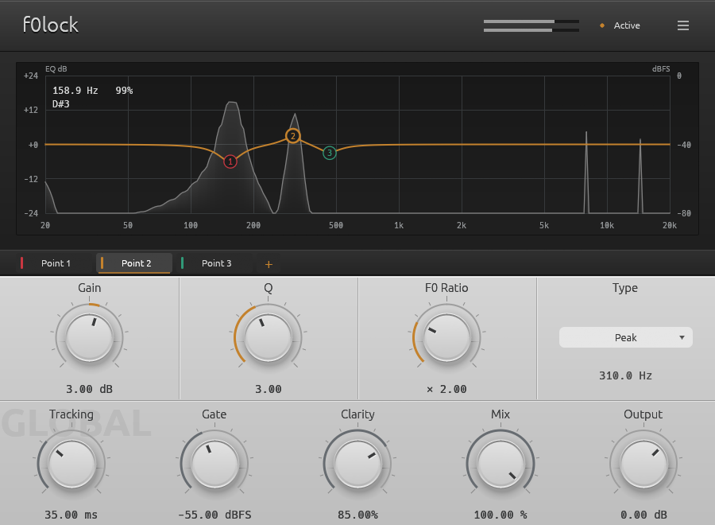

# f0lock

fundamental-tracking dynamic EQ built on nice-plug



## modes

Use the header's mode button to switch between **Track EQ** and **Sidechain EQ**.
Track EQ follows the main input's pitch. Sidechain EQ follows an external
sidechain and applies the EQ to the main input; route the reference track to
the plugin's **Sidechain** input in your host. The spectrum always shows the
main input. Each mode saves its own EQ points, Target and processing settings.

Sidechain EQ uses the configured gain, with Attack and Release controlling
engagement. It is not a level-dependent compressor. An absent or silent
sidechain releases the EQ and displays “Waiting for sidechain pitch”.

## pitch detection

**F0LOCK Ψ** is the default pitch detector for new instances, also selectable
from the header menu's **Pitch Detection** submenu. It evaluates multiple harmonic candidates and follows
their trajectories, rather than requiring the complete mixture to be periodic.
Use **Target → Range / Reference** to identify the voice you want to follow.
The original MPM, MPM + Tracking and pYIN modes remain available.
F0LOCK Ψ supports fundamentals from 50 Hz to 2 kHz; the original detectors
retain their 1 kHz upper limit.

This is pitch tracking, not source separation: an exact octave overlap can still
be ambiguous in Auto. Clarity in this mode measures spectral evidence, so its
values are not directly comparable with MPM / pYIN. See
[the algorithm notes](docs/spectral-melody.md) for implementation and validation.

The spectrum toolbar's **Lookahead** menu offers Minimum, 150, 200 and 300 ms
to process note onsets. It is off by default and reports its latency
to the host. First pitch acquisition now initializes a fully dry EQ directly;
later note changes still use Tracking. See [timing details](docs/lookahead.md).

## building & installing

Install Rust and your platform's native build tools (MSVC on Windows).
The patched dependencies are included in `vendor/`; no sibling folders or submodules are needed.

```powershell
git clone https://github.com/sout233/f0lock.git
cd f0lock
cargo xtask bundle f0lock --release --locked
```

spits out `target/bundled/f0lock.clap` and `target/bundled/f0lock.vst3/`.

Windows frontend runs on wgpu / D3D12, so your box and GPU need legit D3D12 support; if init dies, it fails loudly with an error instead of silently falling back to buggy OpenGL. user UI scale and system DPI are calculated and stored separately so reopening the editor doesn't screw up your window geometry!!!

you can also fire it up standalone to check audio devices and the UI without a host:

```powershell
cargo run --release --features standalone -- --help
```

standalone isn't part of plugin packaging and compiles extra audio I/O crates.


## credits

- Icewatermelon233（谭荣熙竣）
- 网友八顺千


- [nice-plug](https://codeberg.org/RustAudio/nice-plug)
- [pitch-estimate](https://github.com/hey-jj/pitch-estimate)
- [McLeod / Wyvill: A Smarter Way to Find Pitch](https://quod.lib.umich.edu/cgi/p/pod/dod-idx/smarter-way-to-find-pitch.pdf?c=icmc%3Bidno%3Dbbp2372.2005.107%3Bformat%3Dpdf)
- [Cytomic: Linear Trapezoidal Integrated SVF](https://www.cytomic.com/files/dsp/SvfLinearTrapOptimised.pdf)
