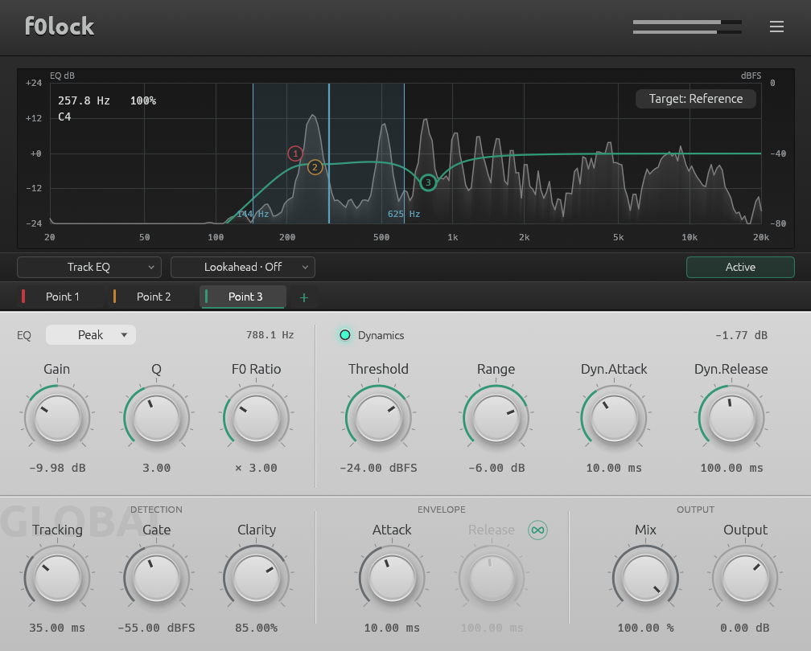

# f0lock

fundamental-tracking dynamic EQ built on nice-plug




## building & installing

Install Rust and your platform's native build tools (MSVC on Windows).

```powershell
git clone https://github.com/sout233/f0lock.git
cd f0lock
cargo xtask bundle f0lock --release --locked
```

spits out `target/bundled/f0lock.clap` and `target/bundled/f0lock.vst3/`.

Windows frontend runs on wgpu / D3D12, so your box and GPU need legit D3D12 support; if init dies, it fails loudly with an error instead of silently falling back to buggy OpenGL!!!

you can also fire it up standalone to check audio devices and the UI without a host:

```powershell
cargo run --release --features standalone -- --help
```

standalone isn't part of plugin packaging and compiles extra audio I/O crates.


## credits

- Icewatermelon233（谭荣熙竣）
- 网友八顺千


- [nice-plug](https://codeberg.org/RustAudio/nice-plug)
- [pitch-estimate](https://github.com/hey-jj/pitch-estimate)
- [McLeod / Wyvill: A Smarter Way to Find Pitch](https://quod.lib.umich.edu/cgi/p/pod/dod-idx/smarter-way-to-find-pitch.pdf?c=icmc%3Bidno%3Dbbp2372.2005.107%3Bformat%3Dpdf)
- [Cytomic: Linear Trapezoidal Integrated SVF](https://www.cytomic.com/files/dsp/SvfLinearTrapOptimised.pdf)
